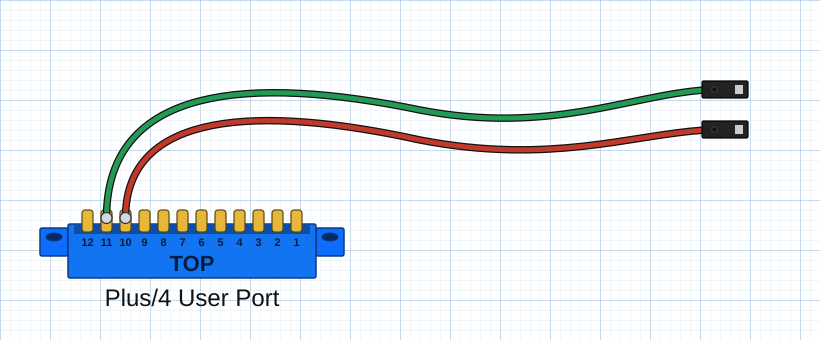

# wic64-library

This is a modified version of the [WiC64 WiFI Adapter Library](https://github.com/WiC64-Team/wic64-library) that adds support for the Commodore 16/+4.

The WiC64 is an ESP32-based adapter that allows Commodore computers to send and receive HTTP requests and to communicate with remote hosts via TCP connections. This library abstracts the low level communication protocol between the C64 and the WiC64 to provide a simple macro based interface for sending commands to the WiC64 and receiving the response to C64 memory or processing it on the fly. It is written in [ACME cross assembler](https://sourceforge.net/projects/acme-crossass/).

> [!IMPORTANT]
> **The WiC64 is not just another modem-like peripheral, it is rather a fully-fledged, blazing-fast network interface!** It can reach ~30 kb/s on the Plus/4!

## Architecture
All the hardware-specific parts have been abstracted into macros. Such macros have been implemented in platform-specific files (`interface_*.asm`), only one of which is included at a time, depending on the target platform.

## Hardware Interface

> [!WARNING]
> Do **NOT** plug the WiC64 into the user port of your Plus/4, it will not work!

As stated above, unfortunately the WiC64 cannot just be plugged in the Plus/4 user port, due to electrical differences with the C64, the computer it was originally designed for. Anyway, there are many other ways to connect it to a Plus/4 and, after many tests and attempts, I settled on using **a [PlusVIA](https://github.com/SukkoPera/PlusVIA) board with a 6522 chip**. This was because of various reasons:
- It makes the interface very close to that used on the C64, which means that no modifications to the WiC64 hardware and firmware are required. Additionally, we can also recycle most of the code on the software side.
- It was the fastest interface in my tests.
- It is very cheap to build and can be completely built with new components: you just need a 6522 chip and a GAL!
- It can be used on the Plus/4, Commodore 16 and Commodore 116, enabling Internet access across the whole 264 family.

> [!IMPORTANT]
> The PlusVIA board must be configured with the default address ($FDCx) and with JP3 set to CB2.

The only drawback is that the WiC64 is normally powered with 9VAC, which is not directly provided by the board, but there are simple solutions to this problem:
- On the Plus/4, build a cable that takes 9V AC from the user port (pins 10 and 11, order doesn't matter) and provides the PlusVIA board with it:
  
- Use an external power supply: this should be 9V AC but others *might* also work: I don't take any responsibility, but if you connect a +5V-9V DC power supply, for instance, to the &plusmn;9VAC pins on the PlusVIA (polarity doesn't matter), it should be enough to power the WiC64.

> [!CAUTION]
> This only works for the WiC64 since it has an onboard bridge rectifier. Do not try it with anything else!

- Make a small modification to the WiC64 board allowing it to be powered from +5V DC, all you need is a diode! Actually, this is the simplest thing you can do and to make it even simpler, I have released [a modified version of the board](https://github.com/SukkoPera/WiC64-Plus4) with the diode already integrated. If you still need to buy/build the board, you can go directly with this!

### Other Interfaces - Unsupported!
For the sake of completeness, here is some information on other things I tried, meant for the advanced curious reader:
- Plus/4 User Port: This required a custom-designed board, which is already enough of a drawback, and anyway it never got even close to the speed and reliability of the other interfaces, due to the lack of HW handshaking lines.
- i8255 chip through a [Plus4i8255](https://github.com/SukkoPera/Plus4i8255) board: This also required a custom-designed board or some very awkward connections, but at least it was relatively reliable, since we can hijack some signals to have HW handshaking. It was not as fast as the PlusVIA though (about 66%).
- PlusVIA with MC6821: This actually works pretty well, but unfortunately it is impossible to buy a brand new MC6821 chip.

Due to how the wic64-library is implemented, and in order to achieve the fastest possible speed, it is not possible to support all of the above interfaces at the same time. Although, the code for all of the above interfaces is still present and can be enabled by defining some macros at build time, see the various `interface_*.asm` files. Although, I cannot guarantee that they will keep working in the future, so please keep in mind that **the PlusVIA with a 6522 chip at address $FDCx is the only supported interface**. Everything else shall be considered experimental and is completely unsupported. Please do not release any software using one of the other interfaces.

## Example
The following code shows how easy it is to retrieve content from a URL with this library, with timeout and error handling:

```asm
main:
    +wic64_execute http_get_request, response
    bcs timeout
    bne error

success:
    +print response
    rts

error:
    +print failure_msg
    rts

timeout:
    +print timeout_error_message
    rts

timeout_error_message: !pet "?timeout error", $00

http_get_request: !byte "R", WIC64_HTTP_GET, <payload_size, >payload_size
http_get_payload: !text "http://x.wic64.net/test/message.txt"
payload_size = * - http_get_payload

failure_msg: !pet "?request failed", $00

response:
```

This is an excerpt from example #2, which can be found [in the examples directory](./examples) together with many more.

To compile the examples for the C64, run:

```console
foo@bar:~$ make
```

To compile for the C16/+4, run:

```console
foo@bar:~$ make PLUS4=1
```

**Please refer to the documentation of the original library to understand how to use it in your programs**.
